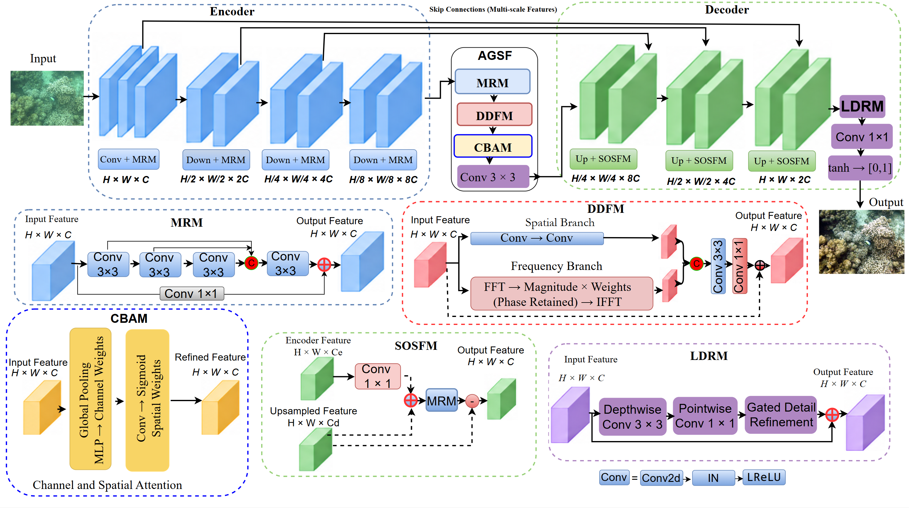

# AGSF-Net for Underwater Image Enhancement

This repository provides the official PyTorch implementation of **AGSF-Net**, an attention-guided spatial--frequency fusion network for underwater image enhancement.

AGSF-Net combines multi-residual feature extraction, dual-domain spatial--frequency fusion, channel--spatial attention, SOS-based decoder reconstruction, and lightweight detail refinement.

## Requirements

- Python 3.10
- PyTorch 2.7.1
- torchvision 0.22.1
- CUDA 12.8
- scikit-image
- NumPy
- tqdm
- Pillow

Install the required packages using:

```bash
pip install -r requirements.txt
```

## Dataset Structure

Prepare paired degraded and reference images as follows:

```text
dataset/
├── train/
│   ├── input/
│   └── target/
└── test/
    ├── input/
    └── target/
```

Input and reference images should have matching filenames.

## AGSF-Net Architecture

AGSF-Net follows an encoder--bottleneck--decoder architecture. The encoder uses multi-residual modules to extract hierarchical features. At the bottleneck, DDFM combines spatial- and Fourier-domain information, while CBAM recalibrates the fused features. The decoder uses SOS-based feature reconstruction modules, followed by LDRM for local-detail refinement before image generation.



## Pretrained Checkpoints and Sample Enhanced Images

The pretrained AGSF-Net checkpoint and sample enhanced images are available through Google Drive:

- [Pretrained Checkpoints](https://drive.google.com/drive/folders/1ha5kFzi9eQLq5OGgegQg5nzEHQoDZzU4?usp=sharing)
- [Sample Enhanced Images](https://drive.google.com/drive/folders/1ha5kFzi9eQLq5OGgegQg5nzEHQoDZzU4?usp=sharing)

## Training

Run the training script using:

```bash
python train.py \
  --train_input /path/to/train/input \
  --train_target /path/to/train/target \
  --epochs 300 \
  --batch_size 8 \
  --image_size 256 \
  --seed 42 \
  --output_dir ./checkpoints
```


## Testing and Inference

Run the testing script using:

```bash
python test.py \
  --ckpt_path ./checkpoints/model_best.pth.tar \
  --raw_test_dir /path/to/test/input \
  --ref_test_dir /path/to/test/target \
  --out_dir ./test_results \
  --image_size 256
```

The script loads the trained model, enhances the input images, saves the results, and calculates PSNR and SSIM.

## Checkpoints

The training script produces:

- `model_best.pth.tar`: checkpoint with the lowest training loss.
- `model_last.pth.tar`: checkpoint from the final training epoch.
- `training_log.csv`: training history.

## Citation

If you use this code in your research, please cite:


```bibtex
@misc{hassan2026agsf,
  title  = {AGSF-Net: Attention-Guided Spatial--Frequency Fusion for Underwater Image Enhancement},
  author = {Hassan, Najmul and others},
  year   = {2026},
  note   = {Manuscript in preparation}
}
```

## Acknowledgements

We thank the authors of the following projects for their inspiration and publicly available resources:

- [AQUA-Net: Adaptive Frequency Fusion and Illumination-Aware Network for Underwater Image Enhancement](https://munsifali11.github.io/AQUA-Net_Project/)
- [UColor: Underwater Image Enhancement via Medium Transmission-Guided Multi-Color Space Embedding](https://li-chongyi.github.io/Proj_Ucolor.html)
- [OUNet-JL: Optimized U-Net Framework With a Joint Loss Function for Underwater Image Enhancement](https://github.com/WangXin81/OUNet_JL)
